# GING

> GING Is Not Gantt, but kind of :)

## Demo

## Features

- [x] keyboard navigation
- [x] responsive / mobile friendly
- [x] handle GitHub login (via Auth0) to save app state to a private Gist

## Thanks

- [Boxy Svg](https://boxy-svg.com) : simple & effective svg editor
- [Github](https://github.com) : for all their great work year after year, pushing OSS forward
- [Knip](https://github.com/webpro/knip) : super tool to find & fix problems
- [Netlify](https://netlify.com) : awesome company that offers free CI & hosting for OSS projects
- [V8](https://github.com/demurgos/v8-coverage) : simple & effective cli for code coverage
- [Oxc](https://oxc.rs) : a lovely super-fast collection of JavaScript tools written in Rust
- [Repo-checker](https://github.com/Shuunen/repo-checker) : checks the repo config & files, while oxlint covers the /src code ^^
- [Shields.io](https://shields.io) : for the nice badges on top of this readme
- [Shuutils](https://github.com/Shuunen/shuutils) : collection of pure JS utils
- [Svg Omg](https://jakearchibald.github.io/svgomg/) : the great king of svg file size reduction
- [TailwindCss](https://tailwindcss.com) : awesome lib to produce maintainable style
- [V8 coverage](https://github.com/vitest-dev/vitest/tree/main/packages/coverage-v8) : simple & effective code coverage via Vitest
- [Vite](https://github.com/vitejs/vite) : super fast frontend tooling
- [Vitest](https://github.com/vitest-dev/vitest) : super fast vite-native testing framework
- [Vue](https://vuejs.org) : when I need a front framework, this is the one I choose <3
